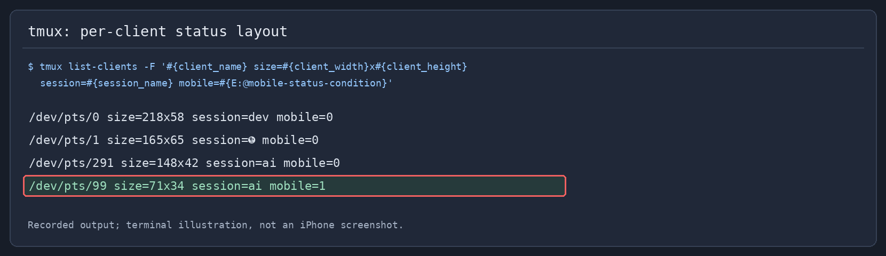

# Fixing duplicated tmux status bars and missing icons in Termius on iPhone


My tmux status bar looked fine on Linux, but connecting to the same session
from Termius on my iPhone left repeated copies of the bar at the bottom of the
screen. Moving it to the top was a useful workaround. I wanted to keep it at
the bottom and keep the desktop&#39;s colors and useful widgets.

The fix was a compact renderer for clients **below 100 columns**, followed by
a targeted replacement for an icon the phone could not render. This extends
my [one-job status renderer]({{&lt; relref &#34;2026-10-02-tmux-lag-round-2&#34; &gt;}}): the
phone still uses one status job, and a desktop attached to the same session
keeps its full layout. The app is **Termius**, although I initially called it
Terminus.

&lt;!--more--&gt;

## What I could establish

The server was running tmux **3.5a**. The iPhone client had **71 columns**, while
one desktop client attached to the same `ai` session had **148 columns**. Both
reported `xterm-256color`.

That ruled out a simple `$TERM` check as a way to identify the phone. The
terminal type described capabilities, not which device was attached.

After loading the first working fix, I checked the client-specific branch:

```bash
tmux list-clients -F &#39;#{client_name} size=#{client_width}x#{client_height} session=#{session_name} mobile=#{E:@mobile-status-condition}&#39;
```

Recorded output from that stage of the debugging session:

```text
/dev/pts/0 size=218x58 session=dev mobile=0
/dev/pts/1 size=165x65 session= mobile=0
/dev/pts/291 size=148x42 session=ai mobile=0
/dev/pts/99 size=71x34 session=ai mobile=1
```



*This is a terminal illustration rendered from the recorded command output,
not a screenshot of the iPhone. Client sizes changed during the session.*

The phone and desktop selected different renderers even when they shared the
same tmux session.

## First, edit the configuration tmux actually uses

My first change went into an old copy under `Documents/myConfig/`, rather than
the active `~/.tmux.conf`. The phone continued to duplicate the bar. Editing a
backup file does not change the running server.

I checked the active options and then changed the live configuration:

```bash
tmux show-options -gv status
tmux show-options -gv status-position
tmux show-options -gv status-left
tmux show-options -gv window-status-current-format
```

The global status setting was `on`, and the position was `bottom`. tmux was
not configured to intentionally show multiple global status rows. My separate
`pane-border-status bottom` setting adds pane labels; those labels are distinct
from repeated copies of the global bar.

## Treat duplicate rows and missing icons as separate failures

A terminal draws text into cells. If tmux counts a symbol as one cell but the
client renders it with a different width, the cursor positions after that
symbol can disagree. Repainting a full bottom row can then leave artifacts.
The [Oh my tmux troubleshooting guide](https://github.com/gpakosz/.tmux#troubleshooting)
describes duplicated status rows caused by disagreements about Unicode widths.

That explanation was consistent with my symptom: the bar contained Powerline
separators, Nerd Font icons, and a long quote. **Switching the phone&#39;s status
text to ASCII stopped the duplication**, and I confirmed that on the phone.
I did not capture terminal traces that isolate one exact offending glyph, so
this is a successful workaround for the observed rendering problem, rather
than proof of a specific Termius implementation bug.

A missing icon is a different question. The font may not contain the requested
glyph, even when the terminal positions the rest of the row correctly. Fixing
width-sensitive output does not automatically add missing glyphs to a font.

## Select the compact layout per client

The important setting in `~/.tmux.conf` is:

```bash
set -g @mobile-status-condition &#39;#{||:#{==:#{@mobile-status},on},#{e|&lt;:#{client_width},100}}&#39;
set -g status on
set -g status-position bottom
```

The condition is true when the client has fewer than 100 columns, or when
`@mobile-status` is explicitly `on`. The format is evaluated for each client
when the status is rendered. Setting a user option to a format string does not
itself evaluate that string; `#{E:@mobile-status-condition}` expands it later
in the relevant client context.

There was a small trap here. My first condition used
`#{&lt;:#{client_width},100}`. In the isolated test on tmux 3.5a, it returned false
at **20 columns**: this comparison follows string ordering. The `e|&lt;` expression
makes the comparison numeric, and all four narrow test widths then selected
compact mode.

Width is a practical heuristic, not a device detector. A narrow desktop also
gets the compact layout, and a phone widened to 100 columns or more gets the
full layout. To force compact mode for the current session:

```bash
tmux set-option @mobile-status on
```

To remove that override and return to width detection:

```bash
tmux set-option -u @mobile-status
```

The explicit override is **session-scoped**. It also affects other clients
attached to that session; the automatic width branch is what lets my phone
and desktop differ in the same session. Setting the override to `off` does
not disable automatic detection in this particular configuration.

## Keep the colors and widgets, simplify the text

The first working phone bar was too plain: short labels and a clock, with most
of the desktop information missing. I kept the ASCII protection but restored
the desktop&#39;s blue session block, cyan active window, muted inactive windows,
and metric colors.

My existing renderer reads finished widget strings from
`~/.cache/tmux-status/`. I added an `ascii` mode to it, rather than adding
another tmux `#()` job for every metric. The relevant options are:

```bash
set -g status-left &#34;#{?#{E:@mobile-status-condition},#($HOME/.tmux/scripts/status-line.sh 0 #{q:session_name} ascii #{client_width}),#{?#{E:#{@quote_cond}},#($HOME/.tmux/scripts/status-line.sh 1 #{q:session_name}),#($HOME/.tmux/scripts/status-line.sh 0 #{q:session_name})}}&#34;
set -g status-right &#34;&#34;
```

These wrap my existing setup: `@quote_cond` controls the desktop quote, and the
background daemon supplies the cached widget values. They are not a complete
replacement for an arbitrary `.tmux.conf`.

The mobile call passes `0` to omit the quote. The desktop keeps its existing
quote rule. `#{q:session_name}` quotes the session name for the shell command.
The renderer still prints both sides of the status line, using
`#[default align=right range=right]` before the metrics and clock.

In ASCII mode, I replace the decorative symbols and metric icons before
stripping other non-ASCII text:

```bash
render_status &#34;$@&#34; | sed \
    -e &#39;s//|/g&#39; -e &#39;s//|/g&#39; -e &#39;s//|/g&#39; -e &#39;s//|/g&#39; \
    -e &#39;s//C/g&#39; -e &#39;s//M/g&#39; \
    -e &#39;s/󰚩/CX/g&#39; -e &#39;s/󰯉/CL/g&#39; -e &#39;s/󰖟/J/g&#39; \
    -e &#39;s//|/g&#39; -e &#39;s// /g&#39; \
    -e &#34;$compact_filter&#34; \
    | LC_ALL=C tr -cd &#39; -~&#39;
```

This is an excerpt from the [full renderer](status-line.sh). The ASCII
`#[...]` color and alignment tags survive the filter, so the phone can retain
the same theme without drawing the original decorative characters.

| Phone label | Value |
|---|---|
| `C` | CPU usage |
| `M` | Memory usage |
| `CX` | Codex remaining quota |
| `CL` | Claude remaining quota |
| `J` | Traffic value |

Below 100 columns, the script also removes reset countdowns in the form
`(HH:MM)` and drops the decimal part of percentages. The clock remains
`HH:MM:SS`, but the date is omitted. The blue session block becomes yellow
while the existing Pomodoro timer is running, just as it does on the desktop.

This changes what fits on the phone: the quote, non-ASCII session text, and
some detail in the metrics are intentionally omitted. It does not translate
Unicode text. The desktop rendering path bypasses the ASCII filter.

The clock is produced by `date`, because my long-running tmux server had
previously retained an old timezone. That is covered in the
[timezone post]({{&lt; relref &#34;2026-09-26-linux-timezone-clock-and-tmux&#34; &gt;}}).

I applied the same client condition to the active and inactive window formats
and the pane-border label. Cleaning only `status-left` would have left symbols
in the other parts of the status display.

## Select the font inside Termius

Installing a Nerd Font on the Linux server does not select the font used by
the iPhone SSH client. The client receives characters and renders them with
its own font.

Termius already bundles patched fonts. Its
[iOS changelog](https://docs.termius.com/changelog/ios) records Nerd Font v3
support in version **5.8.7, released August 7, 2024**, including Meslo,
JetBrainsMono, and FiraCode.

For a current Termius installation:

1. Open the SSH terminal and expand the panel above the keyboard.
2. Open **Themes** and select the font.
3. Try **Meslo** or **JetBrainsMono**.

The [mobile terminal documentation](https://docs.termius.com/terminal/mobile-terminal#themes)
explains that font and theme choices are saved for the host.

A small test avoids using the whole status bar as a font diagnostic:

```bash
printf &#39;Powerline:   | Icons:   󰚩\n&#39;
```

Selecting a font does not disable the ASCII branch in my config. Nor does
support for some Nerd Font characters guarantee support for every icon used
by a desktop configuration.

## Replace the specific unsupported tmux icon

The next reported problem was **``**. My window-name configuration used it both
for the multiple-pane indicator and for the `tmux` and `screen` commands.
I replaced those three mappings with the older Font Awesome columns icon:

| Purpose | Original | Replacement |
|---|---|---|
| Multiple-pane indicator, tmux, screen | `` — U&#43;EBC8 | `` — U&#43;F0DB |

The replacement exists in the
[Font Awesome 4.7 icon definitions](https://github.com/FortAwesome/Font-Awesome/blob/v4.7.0/scss/_variables.scss).
It is a compatibility candidate for older bundled Nerd Fonts; its age alone
cannot guarantee that a particular phone font renders it correctly.

I keep overrides in `~/.config/tmux/tmux-nerd-font-window-name.yml`. These
settings are merged into its existing `config` and `icons` mappings:

```yaml
config:
  multi-pane-icon: &#34;&#34;

icons:
  tmux: &#34;&#34;
  screen: &#34;&#34;
```

My setup compiles that YAML and the plugin&#39;s defaults into a native tmux
`automatic-rename-format`. The generated file is `~/.tmux/window-icons.conf`.
I changed the YAML source and regenerated it, so the next generation would
not undo the icon fix:

```bash
bash ~/.tmux/scripts/gen-window-icons.sh
tmux source-file ~/.tmux/window-icons.conf
```

The [generator](gen-window-icons.sh) is included with this post. It expects
`yq` and the defaults from the installed `tmux-nerd-font-window-name` plugin.
If your setup reads YAML directly through that plugin, use its reload
mechanism instead of assuming this generated file exists.

The compact window format had another problem: its first filter replaced
Unicode characters with `_`, and unknown commands such as Codex contributed
a `?` placeholder. I changed the displayed-name expression to:

```bash
#{s/[^ -~]//;s/[?] //;=8:window_name}
```

It keeps printable ASCII **plus the chosen columns icon**, removes the literal
`? ` placeholder, and limits the result to eight characters. In a shell-only
window whose original name is just a different icon, this filter can leave an
empty label; the window index remains available.

The server-side phone format changed from `_ ? code` to ` codex`. This was
the recorded expansion for the 71-column client:

```text
#[fg=black,bg=cyan,nobold,noitalics,nounderscore] 1|  codex #[fg=cyan,bg=black]
```

I verified that the new generated format differed from the old one only in
those three icon replacements, and that the host&#39;s `wcwidth()` reports one
cell for ``. **Neither check substitutes for looking at the phone.** The
duplicated-row fix was confirmed on the device; the final replacement glyph
still needed visual confirmation there when this post was written.

Shared automatic window names also use the replacement on the desktop. The
desktop&#39;s status colors, metric renderer, and Powerline layout stay as before.
Existing manually named windows can retain an old symbol: updating an
automatic-name format does not rewrite every saved window name.

## Reload the changed options and redraw the phone

During debugging, I loaded only the changed options from a small config
fragment, rather than restarting tmux or re-running every plugin. The final
settings are saved in `~/.tmux.conf`, so normal config reloads retain them.
In my config, that binding is **Ctrl&#43;k, then r**. The usual command is:

```bash
tmux source-file ~/.tmux.conf
```

Then find the phone client and redraw its complete display to clear the old
artifacts:

```bash
tmux list-clients -F &#39;#{client_name} #{client_width}x#{client_height}&#39;
tmux refresh-client -t &lt;phone-client&gt;
```

Use the actual client name from the first command, such as `/dev/pts/99`.
`refresh-client -S` redraws only the status; I used a full redraw to clear the
copies left elsewhere on the screen.

## What was verified

| Check | Result |
|---|---|
| iPhone after the compact renderer was loaded | Duplicate status rows stopped; confirmed on the device |
| Isolated clients at 20, 40, 80, and 99 columns | Compact branch selected |
| Isolated clients at 100 and 148 columns | Desktop branch selected |
| Session override, removal, and config reload | Branches behaved as configured |
| Desktop renderer before and after the phone-style change | Output matched after normalizing the changing clock |
| Final generated icon mapping and compact label | `` replaced in three mappings; `` retained in the phone label |

The useful distinction was between **layout, character width, and font
coverage**. Keeping the desktop colors did not require keeping every desktop
symbol. I kept a conservative text renderer for the narrow client and allowed
one explicit replacement icon in its window labels.


---

> 作者: william  
> URL: https://williamlfang.github.io/2026-10-09-tmux-termius-iphone-status-bar/  

