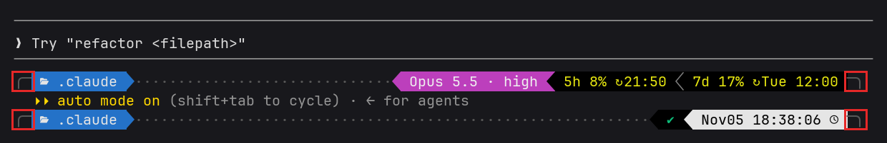

# Lining up the Claude Code status line with my powerlevel10k prompt: padding -2 and a 5-second refresh


I keep Claude Code in a tmux pane above a zsh pane, so its status line sits just
above my zsh prompt, and the two almost matched. Both used the same [powerlevel10k]({{&lt; relref &#34;2024-09-08-powerlevel10k-配置&#34; &gt;}})
colours and separators, but Claude&#39;s line started 2 columns further in and
stopped wherever its text ran out. The zsh line ran the full width of the
terminal, so the pair looked misaligned.

The fix was a dotted gap computed from `$COLUMNS` and **`&#34;padding&#34;: -2`**, a value
the docs don&#39;t mention. Now both prompts start at column 0 and close on the same
column, 134 of 135.

&lt;!--more--&gt;

I asked Claude Code to do this. It made the measurements below in that session,
and it drafted this post from them with the blog skill. I&#39;m using &#34;I&#34; for the session as a
whole, the same way as in my other [Claude Code write-ups]({{&lt; relref &#34;2026-10-02-claude-code-blog-skill-and-agent&#34; &gt;}}).

## The setup

- Claude Code 2.1.316, Linux, running inside tmux
- zsh with powerlevel10k, `POWERLEVEL9K_MODE=nerdfont-v3`
- A two-line p10k prompt with `·` as the gap character
- An existing `~/.claude/statusline-p10k.sh` that already drew p10k-style segments

The two lines looked like this. Pasting from the terminal lost the Nerd Font
glyphs, so the separators are missing, and I shortened the dots and rule. The third line
is the tmux pane border between the two panes:

```text
  ╭─  .claude   Opus 5.5 · high
  ⏵⏵ auto mode on (shift&#43;tab to cycle) · ← for agents
──2 ✳ Claude Code claude &gt;─────────────────────────────────────────────────────
╭─  .claude ······································ ✔  Nov05 18:30:42  ─╮
```

So there were two differences: the 2-column indent, and no gap filling out to
`─╮`.

## Step 1: what the docs say

The [status line docs](https://code.claude.com/docs/en/statusline) answered half
of it. The script runs with its output captured, so `tput cols` can&#39;t see the
terminal, but Claude Code sets `COLUMNS` and `LINES` before running it. That is
enough to compute a gap.

The indent looked worse:

&gt; This padding is in addition to the interface&#39;s built-in spacing, so it controls
&gt; relative indentation rather than absolute distance from the terminal edge.

Going by that, `&#34;padding&#34;: 0` would not reach the edge. I also didn&#39;t know how
many of the `COLUMNS` characters the status line would really display.

## Step 2: measure with a ruler in a real Claude Code

Instead of guessing, I started real `claude` in a throwaway tmux session and used
a ruler as its status line. `--settings` makes this a per-run override, so it
leaves `settings.json` alone.

`probe2.sh`:

```bash
#!/usr/bin/env bash
cat &gt;/dev/null
n=$((COLUMNS - ${OFF:-0}))
s=&#34;&#34;; for ((i=1;i&lt;=n;i&#43;&#43;)); do s&#43;=$((i%10)); done
printf &#39;%s\n&#39; &#34;$s&#34;
```

Running it and reading the screen back:

```bash
tmux new-session -d -s sltest -x 120 -y 30 -c ~/.claude
tmux send-keys -t sltest &#34;claude --settings &#39;{\&#34;statusLine\&#34;:{\&#34;type\&#34;:\&#34;command\&#34;,\&#34;command\&#34;:\&#34;OFF=0 bash $PWD/probe2.sh\&#34;,\&#34;padding\&#34;:0}}&#39;&#34; Enter
# wait for the first render, then look at what actually reached the screen
tmux capture-pane -p -t sltest | grep 123456789
```

The first run confirmed both worries:

```text
  1234567890123456789012345678901234567890 ... 1234567890…
```

The pane came up 135 columns wide rather than the 120 I asked for. I never found
out why, but `COLUMNS` reported 135, so all the numbers below use that. Varying
the offset and the padding gave:

| `padding` | Characters printed | Result |
|---|---|---|
| `0` or unset | 135 | indented 2, truncated with `…` |
| `0` or unset | 133, 132 | indented 2, truncated with `…` |
| `0` or unset | **131** | indented 2, fits |
| `-2` | **135** | **starts at column 0, fits** |
| `-3` | 135 | the first character is cut off |

**The default padding really does leave only `COLUMNS - 4` usable characters**: 2
reserved on each side. A negative value is accepted, and `-2` cancels the
reservation exactly. `-3` goes too far and clips the line.

I also tried a leading `\r` and a cursor-left escape to get out of the indent.
Both runs produced no ruler at all. That was probably my shell quoting rather than
Claude Code, but I didn&#39;t look into it, because `-2` already worked.

## Step 3: copy the gap from the real prompt

Before writing any drawing code, I captured the actual p10k line with its escape
codes. Trimmed:

```bash
tmux capture-pane -p -e -t sltest | grep -m1 &#39;╭─&#39; | sed &#39;s/\x1b/\\e/g&#39;
```

```text
\e[38;5;240m╭─\e[38;5;254m\e[44m  .claude \e[34m\e[49m\e[38;5;240m·········\e[30m\e[32m\e[40m ✔ \e[37m\e[30m\e[47m Nov05 18:33:44  \e[38;5;240m\e[49m─╮\e[39m
```

This gave me three details to copy:

- The dots are colour 240 and touch the separators, with no spaces around them.
- `─╮` is also colour 240, and sits directly after the last segment.
- The directory is plain colour 254. My script drew it bold in colour 255, which
  was simply wrong. It&#39;s 254 at `~`, at `~/.claude` and one level deeper.

## The fix

`~/.claude/settings.json`:

```json
&#34;statusLine&#34;: {
  &#34;type&#34;: &#34;command&#34;,
  &#34;command&#34;: &#34;bash ~/.claude/statusline-p10k.sh&#34;,
  &#34;padding&#34;: -2,
  &#34;refreshInterval&#34;: 5
}
```

The end of `~/.claude/statusline-p10k.sh`, after the left segments are in `$out`
and `draw_right` can render the `right` array (the full script is
[here](statusline-p10k.sh)):

```bash
width() {  # visible columns: drop colour codes, count characters
  local plain
  plain=$(sed &#34;s/$ESC\[[0-9;]*m//g&#34; &lt;&lt;&lt;&#34;$1&#34;)
  echo &#34;${#plain}&#34;
}

# Fill the line like p10k&#39;s gap: ╭─ left ···· right ─╮, ending where the zsh prompt ends.
# Rightmost segments go first when the line does not fit.
suffix=&#34;$(fg 240)─╮$RESET&#34;
cols=$(( ${COLUMNS:-80} - 1 ))   # zsh leaves the last column free
left_width=$(width &#34;$out&#34;)
while :; do
  r=$(draw_right)
  gap=$(( cols - left_width - $(width &#34;$r&#34;) - 2 ))
  (( gap &gt;= 0 || ${#right[@]} == 0 )) &amp;&amp; break
  unset &#39;right[-1]&#39;
done

dots=&#34;&#34;
if (( gap &gt; 0 )); then
  printf -v dots &#39;%*s&#39; &#34;$gap&#34; &#39;&#39;
  dots=${dots// /·}
fi

printf &#39;%s\n&#39; &#34;$out$(fg 240)$dots$RESET$r$suffix&#34;
```

A few details that matter:

- `${#plain}` counts characters only under a UTF-8 locale. Mine is, the probe
  logged `LC_ALL=en_US.UTF-8`, but in a `C` locale it would count bytes and the gap
  would come out wrong.
- The Nerd Font separators count as one column each. The final widths match, so
  that holds here.
- The right segments are ordered by importance, so dropping from the end loses the
  7-day usage first, then the 5-hour usage, then the context bar.

## Two mistakes the real run caught

**The line was one column too wide.** With the gap in place, I compared the two
prompts in real terminals (dots shortened here, widths as measured):

```text
ZSH    (134): ╭─  .claude ···························· ✔  Nov05 18:34:44  ─╮
CLAUDE (135): ╭─  .claude ································· Opus 5.5 · high ─╮
```

I had read the zsh line as 135 wide, because my first measurement piped `grep`
into `wc -m`, which counted the newline. It&#39;s really 134: **zsh leaves the last
column free**. Hence the `- 1` in `cols`.

**Resizing left the line stale.** Claude Code doesn&#39;t rerun the script when the
terminal resizes. Shrinking to 100 columns gave a truncated line:

```text
╭─  .claude ·····················································································…
```

Growing to 150 left it 135 wide, well short of the right edge. `refreshInterval`
reruns the script on a timer as well as on events, and after setting it to 5 both
cases came right within my 7-second wait.

## Results



*A terminal illustration rendered from real `tmux capture-pane -e` output of each
prompt at 100 columns, not a screenshot. The two captures were taken separately
and stacked in the order they appear on my screen. The boxes mark the shared
first and last columns.*

| Check at 135 columns | Before | After |
|---|---|---|
| Start column | 2 | **0**, same as zsh |
| Line width | ends with its text | **134**, same as zsh |
| After resizing to 100 | truncated with `…` | **99**, no truncation |
| After resizing to 150 | stays 135 wide | **149**, no truncation |

The &#34;before&#34; resize rows were measured with `padding: -2` and the gap already in
place, just without `refreshInterval`.

The script on its own, with a sample payload that includes context and usage data:

```bash
for c in 135 100 60 30; do
  l=$(COLUMNS=$c bash ~/.claude/statusline-p10k.sh &lt;&lt;&lt;&#34;$SAMPLE&#34;)
  p=$(sed &#39;s/\x1b\[[0-9;]*m//g&#39; &lt;&lt;&lt;&#34;$l&#34;)   # strip colours, then measure
  echo &#34;cols=$c width=${#p}&#34;; printf &#39;%s\n&#39; &#34;$p&#34;
done
```

```text
cols=135 width=134
╭─  .claude ··········································· Opus 5.5 · high  ctx ▓▓▓▓░░░░░░ 42%  5h 12% ↻05:20  7d 83% ↻Wed 20:26 ─╮
cols=100 width=99
╭─  .claude ········ Opus 5.5 · high  ctx ▓▓▓▓░░░░░░ 42%  5h 12% ↻05:20  7d 83% ↻Wed 20:26 ─╮
cols=60 width=59
╭─  .claude ···· Opus 5.5 · high  ctx ▓▓▓▓░░░░░░ 42% ─╮
cols=30 width=29
╭─  .claude ·············─╮
```

## What this costs

- **`padding: -2` is undocumented.** It works on 2.1.316, but the docs only
  describe padding as extra space. If a later version rejects it, the indent comes
  back and the line ends in `…`. The repair is to delete the setting and change
  `- 1` to `- 4` in `cols`, which matches the 131 characters measured above.
- **`refreshInterval` runs the script every 5 seconds**, including `git status`.
  It&#39;s cheap in most repos, but a very large one might want a longer interval.

I kept Claude&#39;s model, context and usage segments on the right instead of copying
zsh&#39;s `✔` and clock. A clock would be easy to add now that the line refreshes.

## Takeaways

1. **Measure a UI with a ruler.** Printing `1234567890...` through the real program
   settled in a few runs what the docs left open, and turned up a working value
   they don&#39;t list.
2. **Test the real program, not just the script.** Piping JSON into the script gave
   perfect widths. The stale resize only appeared inside a running Claude Code.
3. **Copy from `capture-pane -e`.** The real escape codes showed the colours and
   spacing directly, including a bold directory I&#39;d been getting wrong.
4. **`wc -m` counts the newline.** Use `printf &#39;%s&#39;` when a width has to be exact.
   A similar width-sensitive status bar problem came up with
   [tmux on my phone]({{&lt; relref &#34;2026-10-09-tmux-termius-iphone-status-bar&#34; &gt;}}).

## References

- [Claude Code status line docs](https://code.claude.com/docs/en/statusline)
- [powerlevel10k](https://github.com/romkatv/powerlevel10k)


---

> 作者: william  
> URL: https://williamlfang.github.io/2026-11-05-claude-code-statusline-p10k/  

