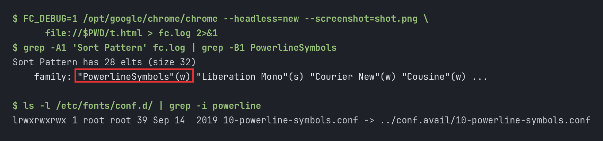
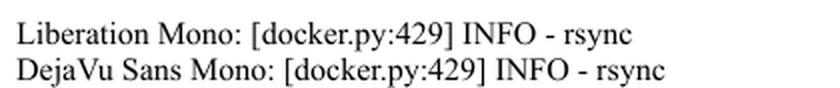
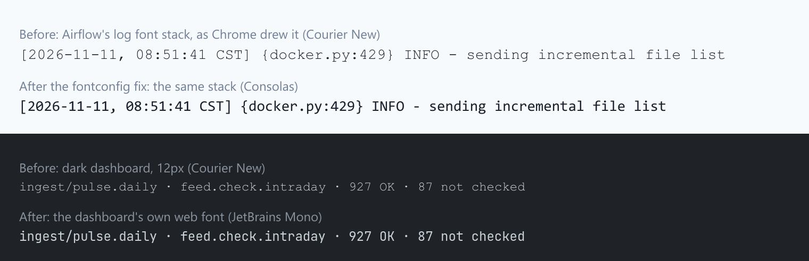

# Thin, pale monospace in Chrome: a Powerline font config was vetoing every good mono font


Two pages I look at every day had the same problem: monospace text that was too
thin and pale to read comfortably. One was the log viewer in our Airflow 2.7 web
UI, the other the dark theme of an internal Tabler dashboard. In both, Chrome was
drawing the text in **Courier New**, a hairline font, even though both pages list
four or five better fonts before it.

The cause was a fontconfig file from the `fonts-powerline` package, installed in
2019. It puts the symbols-only &#34;PowerlineSymbols&#34; font **in front of** most
monospace families, and Chrome then refuses every one of them. A one-rule
fontconfig file fixed it.

&lt;!--more--&gt;



## The setup

- Linux Mint 20.3, Google Chrome 129.0.6668.100, fontconfig 2.13.1
- `fonts-powerline` 2.7-3 (for the terminal&#39;s status line) and the Microsoft core
  fonts (which bring Courier New)
- Two pages with the same symptom:
  - Airflow 2.7.3&#39;s log viewer. Its Chakra UI theme asks for
    `SFMono-Regular,Menlo,Monaco,Consolas,&#34;Liberation Mono&#34;,&#34;Courier New&#34;,monospace`.
  - A Tabler 1.6 dashboard. Tabler&#39;s `--tblr-font-monospace` is
    `ui-monospace,SFMono-Regular,Menlo,Monaco,Consolas,Liberation Mono,Courier New,monospace`.

## Step 1: ask Chrome which font it actually used

`fc-match` is not the answer to &#34;what does Chrome draw&#34;. It said every font in
the list was there:

```bash
for f in Consolas &#34;Liberation Mono&#34; &#34;Courier New&#34; monospace; do
  printf &#39;%-16s -&gt; &#39; &#34;$f&#34;; fc-match &#34;$f&#34;
done
```

```text
Consolas         -&gt; consolas-regular.ttf: &#34;Consolas&#34; &#34;Regular&#34;
Liberation Mono  -&gt; LiberationMono-Regular.ttf: &#34;Liberation Mono&#34; &#34;Regular&#34;
Courier New      -&gt; Courier_New.ttf: &#34;Courier New&#34; &#34;Regular&#34;
monospace        -&gt; DejaVuSansMono.ttf: &#34;DejaVu Sans Mono&#34; &#34;Book&#34;
```

Chrome can tell you what it really used. In DevTools, the Computed tab lists
&#34;Rendered Fonts&#34; at the bottom. From a script, the DevTools protocol call
`CSS.getPlatformFontsForNode` gives the same answer. For the dashboard&#39;s
monospace text it said:

```text
font-monospace: [(&#39;Courier New&#39;, &#39;CourierNewPSMT&#39;, 20)]
```

I then gave each candidate font its own line of text and asked again:

| `font-family` asked for | Chrome drew it in |
|---|---|
| `Consolas` | Times New Roman |
| `Liberation Mono` | Times New Roman |
| `DejaVu Sans Mono` | Times New Roman |
| `monospace` | Times New Roman |
| `JetBrains Mono` | **JetBrains Mono** |
| `SF Mono` | **SF Mono** |
| `Fira Code` | **Fira Code Medium** |

All of these are installed, and fontconfig finds every one. Chrome treated half
of them as missing. With Menlo, Monaco, Consolas and Liberation Mono all
&#34;missing&#34;, the first name left in either stack is Courier New.

## Step 2: fix the page I own

For the dashboard I don&#39;t have to depend on what each computer has installed. It
now ships its own font: JetBrains Mono from `@fontsource` (regular and bold,
264 KB including every script subset; the browser downloads only the subsets a
page uses), placed first in the stack:

```css
:root {
  --tblr-font-monospace: &#34;JetBrains Mono&#34;, ui-monospace, SFMono-Regular, Menlo,
                          Monaco, Consolas, &#34;Liberation Mono&#34;, monospace;
}
```

One detail that matters: the dashboard&#39;s &#34;export as picture&#34; button draws through
an SVG, which can&#39;t load web fonts, so the font has to be embedded by hand. The
code that works out which fonts to embed was reading the computed font of a
*detached* copy of the card, which has none, so the picture dropped back to a
fallback font. Working out the fonts after the copy is attached fixed it.

That fixes one site. Airflow is someone else&#39;s bundle, and the real problem is in
Chrome on this machine.

## Step 3: wrong turns in fontconfig

### Hide Courier New

A user-level `&lt;rejectfont&gt;` for the Microsoft Courier New files. If Courier New
is gone, the stack should land on Liberation Mono. It didn&#39;t: Chrome drew the log
line in **Times New Roman**, a proportional serif. That was worse, so I removed
the rule. It was also the first hint that Chrome couldn&#39;t use Liberation Mono at
all:



### Teach JetBrains Mono to answer to &#34;Menlo&#34;

Chrome does use JetBrains Mono, and both stacks name Menlo early. So I gave
JetBrains Mono a second family name, &#34;Menlo&#34;, with a `&lt;match target=&#34;scan&#34;&gt;`
rule. That had no effect on the system copy, because system font folders are
cached by root and a user scan rule never reaches them. On copies in
`~/.local/share/fonts`, `fc-match Menlo` did return JetBrains Mono, but Chrome
still drew Courier New. That stayed true even with &#34;Menlo&#34; listed first. That
looked like nonsense at the time; Step 4 explains it.

### WOFF files in the font folder

Some of the debug output pointed at Source Code Pro `.woff` files in
`~/.local/share/fonts`. Rejecting every `*.woff` and `*.woff2` changed nothing.

## Step 4: watch Chrome&#39;s own fontconfig queries

fontconfig prints every query it handles when `FC_DEBUG=1` is set. Chrome uses
the system `libfontconfig.so.1`, so this works on Chrome too. The test page,
`t.html`, has one line each in `&#39;Liberation Mono&#39;`, `&#39;DejaVu Sans Mono&#39;`,
`monospace` and `&#39;Courier New&#39;`:

```bash
FC_DEBUG=1 /opt/google/chrome/chrome --headless=new --screenshot=shot.png \
    file://$PWD/t.html &gt; fc.log 2&gt;&amp;1
grep -A1 &#39;Sort Pattern&#39; fc.log | grep -B1 PowerlineSymbols
```

```text
Sort Pattern has 28 elts (size 32)
	family: &#34;PowerlineSymbols&#34;(w) &#34;Liberation Mono&#34;(s) &#34;Courier New&#34;(w) &#34;Cousine&#34;(w) ...
```

Chrome asked for Liberation Mono, but by the time the query reaches fontconfig&#39;s
sort, **`PowerlineSymbols` is in front of it**. Something in the config was
prepending it:

```bash
ls -l /etc/fonts/conf.d/ | grep -i powerline
```

```text
lrwxrwxrwx 1 root root 39 Sep 14  2019 10-powerline-symbols.conf -&gt; ../conf.avail/10-powerline-symbols.conf
```

`/etc/fonts/conf.avail/10-powerline-symbols.conf` (from `fonts-powerline`) is 25
of these:

```xml
&lt;alias&gt;
	&lt;family&gt;Liberation Mono&lt;/family&gt;
	&lt;prefer&gt;&lt;family&gt;PowerlineSymbols&lt;/family&gt;&lt;/prefer&gt;
&lt;/alias&gt;
```

one each for `monospace`, Droid Sans Mono, DejaVu Sans Mono, Inconsolata, Lucida
Console, **Monaco, Menlo**, Source Code Pro, **Consolas**, Bitstream Vera Sans
Mono, **Liberation Mono**, Ubuntu Mono, the Meslo variants and a few more.

## Why Chrome ends up on Courier New

The idea behind the file is fallback: if your terminal font lacks the Powerline
arrow glyphs, take them from PowerlineSymbols. Terminals build a chain of fonts,
so it works there. But `&lt;prefer&gt;` puts PowerlineSymbols **first**, and the best
match fontconfig returns is then a symbols-only font, not the one asked for.

As far as I can tell from how it behaves, Chrome checks that the family it gets
back is the family it asked for. When it isn&#39;t, Chrome acts as if the font isn&#39;t
installed and moves to the next name in the CSS list. That explains every row of
the Step 1 table:

| Font | In the Powerline list? | Chrome |
|---|---|---|
| Menlo, Monaco, Consolas, Liberation Mono, DejaVu Sans Mono, `monospace` | yes | dropped |
| Courier New | **no** | used |
| JetBrains Mono, SF Mono, Fira Code | no | used |

It also explains the &#34;Menlo&#34; attempt in Step 3: Menlo is in the list, so a font
named Menlo got PowerlineSymbols put in front of it too.

So for both stacks, every font up to Courier New was vetoed, and Courier New
won. Nothing else showed the problem. Terminals use their own font lists,
fc-match reports the right font, and other browsers&#39; and toolkits&#39; matching
differ.

## The fix

Remove the link (the package keeps the file in `conf.avail`, so reinstalling can
bring the link back):

```bash
sudo rm /etc/fonts/conf.d/10-powerline-symbols.conf
```

Or, without sudo, undo it for your user. User config is loaded later
(`50-user.conf`), so a rule there can delete PowerlineSymbols from every request
again. I keep this one as well, in case a package upgrade restores the link.

`~/.config/fontconfig/conf.d/60-chrome-mono-powerline.conf`:

```xml
&lt;?xml version=&#34;1.0&#34;?&gt;
&lt;!DOCTYPE fontconfig SYSTEM &#34;urn:fontconfig:fonts.dtd&#34;&gt;
&lt;fontconfig&gt;
  &lt;match target=&#34;pattern&#34;&gt;
    &lt;test qual=&#34;any&#34; name=&#34;family&#34;&gt;&lt;string&gt;PowerlineSymbols&lt;/string&gt;&lt;/test&gt;
    &lt;edit name=&#34;family&#34; mode=&#34;delete&#34;/&gt;
  &lt;/match&gt;
&lt;/fontconfig&gt;
```

A few details that matter:

- **Chrome reads fontconfig once, at startup.** Closing a window isn&#39;t enough:
  quit it completely (Ctrl&#43;Shift&#43;Q) and reopen it.
- A quick check before and after: paste this into the address bar. When the fix
  is active, the first line is clearly heavier than the second.

  ```text
  data:text/html,&lt;div style=&#34;font:20px Menlo,&#39;Courier New&#39;&#34;&gt;Menlo 0O1l [docker.py:429] INFO&lt;/div&gt;&lt;div style=&#34;font:20px &#39;Courier New&#39;&#34;&gt;Courier 0O1l [docker.py:429] INFO&lt;/div&gt;
  ```

- Check `chrome://settings/fonts` too. My **Fixed-width font** was set to
  `JetBrainsMonoNL Nerd Font Propo`, which is a *proportional* variant, so
  anything styled as plain `monospace` was not monospaced. I set it to JetBrains
  Mono.

## Results

From `CSS.getPlatformFontsForNode` in a fresh Chrome process (same binary, same
user):

| Text | Before | After |
|---|---|---|
| Airflow&#39;s log stack | Courier New | **Consolas** |
| Tabler&#39;s stack | Courier New | **Consolas** |
| The dashboard (own web font) | Courier New | **JetBrains Mono** |



One thing I didn&#39;t settle: in a fresh headless profile, plain `monospace` still
came out as Times New Roman after the fix. A fresh profile has no fixed-width
font chosen, so this may be a headless default. In my real profile the
fixed-width setting above covers it.

## Takeaways

1. **`fc-match` is not what the browser does.** It reported the right font for
   every name, while Chrome dropped half of them. Ask Chrome itself: DevTools&#39;
   Rendered Fonts, or `CSS.getPlatformFontsForNode`.
2. **`FC_DEBUG=1` works on any program that uses fontconfig, Chrome included.**
   The &#34;Sort Pattern&#34; lines show the request after every config file has
   rewritten it. That is where the bad family showed up.
3. **`&lt;prefer&gt;` is not &#34;fall back to&#34;.** It puts the font first. For a
   symbols-only font that&#39;s wrong everywhere except a terminal.
4. **If you control the page, ship the font.** A font stack that only names
   system fonts looks different on every machine. A 264 KB web font removes the
   question.
5. **Don&#39;t stack fixes you can&#39;t explain.** I tried three fontconfig changes that
   didn&#39;t help, and removed each one before trying the next. In the end, one
   debug flag gave the answer.

## References

- fontconfig user documentation, `&lt;alias&gt;`, `&lt;prefer&gt;`, `&lt;match&gt;` and `FC_DEBUG`:
  &lt;https://www.freedesktop.org/software/fontconfig/fontconfig-user.html&gt;
- The Powerline fonts config: `dpkg -L fonts-powerline`,
  `/etc/fonts/conf.avail/10-powerline-symbols.conf`
- Chrome DevTools Protocol, `CSS.getPlatformFontsForNode`:
  &lt;https://chromedevtools.github.io/devtools-protocol/tot/CSS/#method-getPlatformFontsForNode&gt;


---

> 作者: william  
> URL: https://williamlfang.github.io/2026-11-11-chrome-thin-monospace-powerline/  

