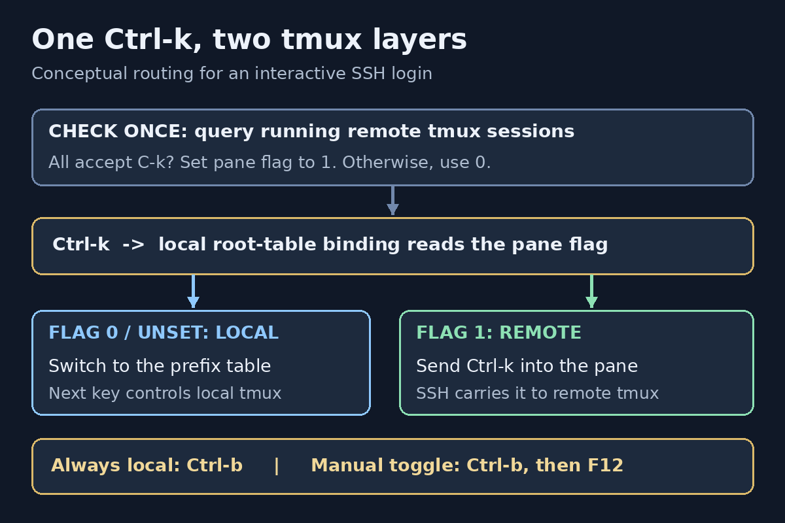

# Nested tmux over SSH: automatically route Ctrl-k to the remote


My local tmux and one remote tmux both used `Ctrl-k` as their prefix. After connecting over SSH, `Ctrl-k c` still created a **local** window. The local tmux consumed the prefix before SSH could send it to the server.

I wanted `Ctrl-k` to control the remote when its tmux also accepted `Ctrl-k`, but stay local for other servers. The working solution uses a pane-local flag and one SSH probe per login. `Ctrl-b` remains an always-local escape hatch.

&lt;!--more--&gt;

## The setup and the behavior I wanted

My local setup runs tmux 3.5a with zsh. The connection in question is:

```bash
ssh william@127.0.0.1 -p62222
```

The loopback address and port are simply this connection&#39;s endpoint. Nothing in the solution hard-codes them; it should also work with an SSH host alias or a normal hostname.

Before the change, both tmux instances had the equivalent of:

```tmux
set -g prefix C-k
```

The desired routing was:

| Context | `Ctrl-k` | `Ctrl-b` |
|---|---|---|
| Local shell | Local prefix | Local prefix |
| SSH login; running remote sessions all accept `Ctrl-k` | Forward to remote | Local prefix |
| SSH login; remote uses another prefix | Local prefix | Local prefix |
| Probe fails or finds no running tmux | Local prefix | Local prefix |

Here, “accept” means either the remote session&#39;s `prefix` or `prefix2` is `C-k`.



*Conceptual illustration, not a captured terminal trace. The SSH check sets the flag once; pressing a key does not launch another probe.*

## Why sending the prefix twice was not enough

A conventional nested-tmux setup provides a `send-prefix` binding. The first prefix addresses local tmux; a second key sends a prefix through to the inner tmux.

That is useful, but it was not the behavior I wanted. I wanted the same single `Ctrl-k` press to choose the right layer automatically.

There was another constraint: my existing `Ctrl-k Ctrl-k` binding resizes a pane upward:

```tmux
bind -r C-k resize-pane -U 5
```

Replacing that with `send-prefix` would silently remove an existing shortcut. The solution needed to preserve the prefix table, not rebuild it.

## Local tmux cannot discover a remote prefix by itself

SSH carries terminal input and output. It does not advertise the remote tmux configuration to the local tmux.

Looking at the local pane&#39;s process name only tells me that it is running `ssh`. It does not tell me whether a remote tmux exists, which session I will attach to, or what that session&#39;s prefix is.

**Auto-detection therefore needs a remote query.** The useful query is:

```bash
tmux list-sessions -F &#39;#{prefix} #{prefix2}&#39;
```

It reads the effective prefix settings of running sessions on the default remote tmux socket. It does not start a tmux server or parse a configuration file.

The conservative policy is:

- At least one session must be returned.
- Every returned session must accept `C-k` in either prefix slot.
- Any failure or ambiguous mixture keeps `Ctrl-k` local.

Checking every session avoids guessing which one a later `tmux attach` will choose. It still cannot identify the active application inside the remote terminal; that limitation matters later.

## Step 1: dispatch Ctrl-k in the local root table

Add this block at the **end of the local `~/.tmux.conf`**, after earlier prefix settings and plugin initialization:

```tmux
## Local and remote tmux: Ctrl-b is always local.
set -g prefix C-b
set -g prefix2 None

## Ctrl-k forwards only in a pane marked by the SSH helper.
bind-key -T root C-k if-shell -F &#39;#{==:#{@remote_ctrl_k},1}&#39; \
    &#39;send-keys C-k&#39; \
    &#39;switch-client -T prefix&#39;

## Manual override when the probe cannot determine the desired behavior.
bind-key -T prefix F12 if-shell -F &#39;#{==:#{@remote_ctrl_k},1}&#39; \
    &#39;set-option -pu @remote_ctrl_k; display-message &#34;Ctrl-k controls LOCAL tmux&#34;&#39; \
    &#39;set-option -p @remote_ctrl_k 1; display-message &#34;Ctrl-k controls REMOTE tmux; Ctrl-b stays local&#34;&#39;
```

The actual tmux `prefix` becomes `C-b`. `Ctrl-k` instead becomes a normal key binding in the `root` table:

1. With `@remote_ctrl_k` equal to `1`, `send-keys C-k` writes the key into the pane. SSH then carries it to the remote.
2. Otherwise, `switch-client -T prefix` makes the next key use the existing local prefix table.

Keeping `prefix C-k` and merely adding a root-table binding would not work: tmux would recognize its prefix first instead of dispatching that root binding.

The `-F` option is important. The condition is evaluated as a tmux format; **it does not spawn a shell for each key press**. This follows the same keep-forks-out-of-the-input-path principle from my [tmux latency investigation]({{&lt; relref &#34;2026-10-02-tmux-lag-round-2&#34; &gt;}}).

The routing flag is pane-local, not global. Two panes connected to different servers can therefore make different decisions.

Existing prefix-table commands are untouched. In an ordinary local pane, `Ctrl-k Ctrl-k` still runs the resize binding. In a forwarding pane, `Ctrl-b Ctrl-k` addresses that same local resize command.

Do not copy this block to the remote configuration. The remote can keep its normal `prefix C-k`.

## Step 2: probe before an interactive SSH login

The helper is available as a [downloadable Bash script](ssh-auto-prefix.sh). Save it locally as `~/.tmux/scripts/ssh-auto-prefix.sh`. It is invoked with `bash`, so an executable bit is not required.

The central probe is:

```bash
prefixes=$(command ssh \
    -o BatchMode=yes -o ConnectTimeout=4 -o ConnectionAttempts=1 \
    -o ClearAllForwardings=yes -o PermitLocalCommand=no \
    -o RemoteCommand=none -o RequestTTY=no -o ControlMaster=no \
    &#34;$@&#34; &#34;tmux list-sessions -F &#39;#{prefix} #{prefix2}&#39; 2&gt;/dev/null&#34; \
    2&gt;/dev/null) || prefixes=
```

A few details matter:

- **No second password prompt.** `BatchMode=yes` makes the probe noninteractive. It needs an identity or an existing connection that can authenticate without prompting. If that is unavailable, the regular SSH login still runs normally, with local key routing.
- **Reuse connection settings.** The original arguments carry the host, port, identity, config file, and jump-host options. The probe&#39;s protective options come first because OpenSSH generally uses the first obtained value for each option.
- **Avoid login side effects where possible.** The probe requests no terminal, clears configured forwarding, disables `LocalCommand`, and overrides `RemoteCommand`. It is still a real SSH command: remote shell startup and server-side SSH policy can affect it.
- **Do not probe on every key press.** The query runs once before the login. There is no periodic remote polling.
- **Preserve ordinary command invocations.** The argument scanner skips detection for explicit remote commands and noninteractive modes such as `-N`, `-T`, and `-W`. It is a small scanner, not a complete replacement for OpenSSH&#39;s parser; unusual invocations should bypass the wrapper.

After a successful match, the helper sets:

```bash
command tmux set-option -p -t &#34;$TMUX_PANE&#34; @remote_ctrl_k 1
```

For an eligible login whose probe fails or does not match, it sets the flag to `0`. That prevents an old manual forwarding flag from accidentally carrying over into a different connection.

The helper saves the previous pane value and uses an `EXIT` trap to restore it after SSH exits. If there was no previous value, it unsets the pane option. Normal disconnects therefore return the pane to its previous behavior.

It also prints this notice when forwarding is enabled:

```text
[tmux] Remote uses Ctrl-k: forwarding Ctrl-k; Ctrl-b controls local tmux.
```

## Step 3: wrap ssh in the local zsh configuration

Add this function to the **local `~/.zshrc`**:

```zsh
## SSH: automatically give Ctrl-k to remote tmux when its prefix matches.
## Use `command ssh ...` to bypass detection; Ctrl-b F12 toggles it manually.
ssh() {
    if [[ -n $TMUX &amp;&amp; -n $TMUX_PANE ]]; then
        bash &#34;$HOME/.tmux/scripts/ssh-auto-prefix.sh&#34; &#34;$@&#34;
    else
        command ssh &#34;$@&#34;
    fi
}
```

`command ssh` calls the real SSH executable rather than recursively invoking the function. The helper also uses `command tmux`, which avoids my local oh-my-zsh tmux alias.

Load the configuration from a local terminal:

```bash
command tmux source-file ~/.tmux.conf
source ~/.zshrc
```

Then connect with the usual command:

```bash
ssh william@127.0.0.1 -p62222
```

There is no special host-specific function to remember. Outside tmux, the wrapper simply calls SSH without a probe.

## Checking the result

These local commands inspect the installed configuration:

```bash
command tmux show-options -g prefix
command tmux list-keys -T root C-k
command tmux list-keys -T prefix C-k
```

In my setup, the checks returned:

```text
prefix C-b
bind-key -T root C-k if-shell -F &#34;#{==:#{@remote_ctrl_k},1}&#34; &#34;send-keys C-k&#34; &#34;switch-client -T prefix&#34;
bind-key -r -T prefix C-k resize-pane -U 5
```

The important combination is `prefix C-b`, a conditional root binding for `C-k`, and the original resize binding still present.

I checked the helper with `bash -n` and ShellCheck. Mocked SSH tests covered matching prefixes, different prefixes, a matching secondary prefix, mixed sessions, no tmux, probe failure, remote commands, a tunnel invocation, and SSH config options. A throwaway tmux server verified that the bindings loaded, the resize binding survived, and the manual toggle worked in both directions.

Those checks were followed by the actual SSH connection: automatic routing worked in that connection. The mocked tests are not evidence that every possible SSH option combination works.

When forwarding is active:

| Keys | Action |
|---|---|
| `Ctrl-k`, then `c` | Create a remote tmux window |
| `Ctrl-b`, then `c` | Create a local tmux window |
| `Ctrl-b`, then `F12` | Toggle Ctrl-k routing manually |

The `c` actions assume the usual tmux binding for creating a window.

## Limits worth keeping visible

This is **connection-time prefix detection**, not continuous detection of the foreground remote application.

- **Forwarding covers the entire SSH login.** If I detach from remote tmux but keep the SSH connection open, `Ctrl-k` still goes to the remote shell. `Ctrl-b F12` switches it back manually.
- **No running remote server means no match.** If I start tmux only after logging in, the earlier probe cannot know its prefix. I can use the manual toggle rather than guessing from an unexecuted config file.
- **Mixed session prefixes deliberately fall back.** Even if I intend to attach to a matching session, another nonmatching session makes the result ambiguous.
- **Custom sockets are not discovered.** Sessions started with `tmux -L ...` or `tmux -S ...` need a correspondingly targeted query.
- **The remote noninteractive PATH matters.** A tmux binary available only after an interactive shell setup may not be found by the probe.
- **There is an extra SSH command before login.** `ConnectTimeout=4` limits connection establishment, not the complete remote command. Slow jump hosts or shell startup can still add delay.
- **Remote policy and output can interfere.** Restricted accounts, forced commands, or shell startup text may prevent a clean prefix result. This helper is for ordinary, trusted login accounts, not a universal SSH frontend.
- **Cleanup is best effort.** Normal exits restore the flag. An uncatchable termination such as `SIGKILL` can leave it set; the manual toggle is the recovery path.
- **Copy mode is separate.** These bindings govern normal pane input, not every key table used by local tmux copy mode.

To skip all detection for a particular invocation:

```bash
command ssh william@127.0.0.1 -p62222
```

Bypassing the wrapper does not itself clear a manually enabled pane flag; use `Ctrl-b F12` if necessary.

One more detail: because the actual local `prefix` is now `C-b`, plugins or custom bindings that inspect `#{prefix}` or run `send-prefix` see `C-b`, not the synthetic `Ctrl-k` dispatcher. Check those separately if the configuration relies on them.

## Takeaway

The fix was to separate **the key I press** from **tmux&#39;s actual prefix setting**. `Ctrl-k` becomes a conditional dispatcher, while `Ctrl-b` remains a reliable route to the outer tmux.

The remote query only decides a pane flag. Keeping that network operation out of the key path makes the behavior simple: unknown means local, a confirmed matching prefix means remote, and the manual override is always reachable.

## References

- [tmux manual: key bindings, formats, and options](https://man.openbsd.org/tmux)
- [ssh manual](https://man.openbsd.org/ssh)
- [ssh_config manual: BatchMode, RemoteCommand, and connection options](https://man.openbsd.org/ssh_config)


---

> 作者: william  
> URL: https://williamlfang.github.io/2026-11-14-tmux-ssh-auto-prefix/  

