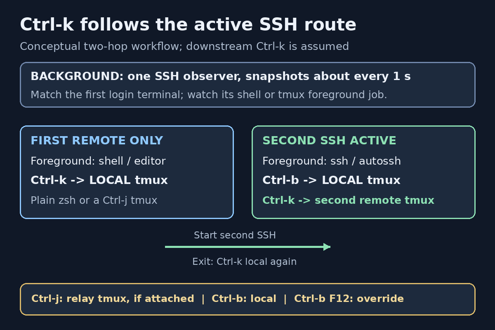

# Nested tmux over SSH: dynamically route Ctrl-k across two hops


&gt; **Update 2026-11-21:** I tested real keystrokes through the two-hop login, including the return to the relay shell. Direct logins through my forwarded ports exposed a separate problem: the TCP source port changes in transit, so the observer cannot match the login terminal. See [the forwarded-port fix for `nb` and `nbx`]({{&lt; relref &#34;2026-11-21-tmux-ctrl-k-ssh-forwarded-ports&#34; &gt;}}) for the updated helper and test results.

&gt; **Update 2026-11-15:** there were two corrections. Always forwarding for a relay hostname broke local `Ctrl-k` when no second hop was active. Watching only remote tmux panes then missed my actual `ssh → zsh → nb → ta zsh` path: the first hop was a plain shell, not a tmux client. The observer now correlates the interactive SSH connection with its remote login terminal and inspects that terminal&#39;s foreground job. Both downloads below are required; reconnect the first SSH login after updating the observer. Hostnames are anonymized.

My local tmux and the tmux behind a second SSH hop both use `Ctrl-k`. The first remote uses `Ctrl-j`. I wanted the prefixes to coexist without an extra escape sequence before every command.

The intended mapping is: **`Ctrl-k` stays local until the first remote&#39;s login terminal, or its active tmux pane, runs another SSH connection.** Then `Ctrl-b` controls local tmux and `Ctrl-k` goes downstream. If a first-remote tmux is attached, `Ctrl-j` still controls it. Leaving the second connection returns `Ctrl-k` to local tmux. The live check verified detection of my nested SSH; it was not a complete keyboard test of every transition.

&lt;!--more--&gt;

## The setup and the behavior I wanted

My local setup runs tmux 3.5a with zsh. The first remote runs tmux 3.4. The route is:

```text
Local tmux (synthetic Ctrl-k dispatcher; actual prefix Ctrl-b)
  -&gt; SSH to relay.example
     First remote tmux (Ctrl-j)
       -&gt; SSH to second host
          Second remote tmux (Ctrl-k)
```

`relay.example` replaces my private hostname. The LAN endpoint below is an example; use your own host and port:

```bash
# From the local zsh shell:
ssh relay.example

# Then, inside the first remote&#39;s tmux:
ssh william@192.168.1.82 -p62223
```

The route above is supported, but it was not the path I actually used when debugging the remaining failure:

```text
Local tmux
  -&gt; ssh relay.example
     -&gt; plain zsh shell
        -&gt; nb (SSH to the second host)
           -&gt; ta zsh (attach the second host&#39;s tmux; Ctrl-k)
```

The commands I typed were:

```zsh
ssh relay.example
zsh
nb
ta zsh
```

`nb` is my shortcut for the second SSH connection; `ta zsh` attaches the second host&#39;s tmux session. These are personal shortcuts, not standard commands. Use `ssh william@192.168.1.82 -p62223` and `tmux attach-session -t zsh` for the equivalent explicit operations. **Starting zsh on the first host does not attach its tmux.** A detached `Ctrl-j` tmux elsewhere on that host cannot tell me what this login terminal is doing.

The desired mapping when the first tmux is attached is:

| State | Local tmux | First remote tmux | Second remote tmux |
|---|---|---|---|
| Local shell, no SSH | `Ctrl-k` | — | — |
| First remote only; active pane is a shell/editor | **`Ctrl-k`** | `Ctrl-j` | — |
| Active first-remote pane runs the second SSH | **`Ctrl-b`** | `Ctrl-j` | **`Ctrl-k`** |
| Second SSH exits back to the first remote | **`Ctrl-k` again** | `Ctrl-j` | — |

For the plain-shell path, the local and second-remote columns are the same; there simply is no first-remote tmux to control with `Ctrl-j`.

`Ctrl-b` remains available locally in every state. Each prefix is followed directly by its normal command key: `Ctrl-k c`, for example, creates a local window in the first-remote-only state and a downstream window in the two-hop state.



*Conceptual illustration, not a terminal capture. A background observer updates the pane flag; a key press only evaluates that flag inside local tmux.*

## Why sending the prefix twice was not enough

A conventional nested-tmux setup provides a `send-prefix` binding. The first prefix addresses local tmux; another key sends a prefix to the inner tmux.

That works, but it is not the behavior I wanted. I also already use `Ctrl-k Ctrl-k` to resize a local pane upward:

```tmux
bind -r C-k resize-pane -U 5
```

Replacing it with `send-prefix` would remove an existing shortcut. The solution should preserve the prefix table and only decide **which layer receives the prefix**.

## Why the static relay rule was wrong

The first implementation probed remote prefixes once at login. That handled a direct `Ctrl-k` remote, but could not see a second SSH connection started later inside a `Ctrl-j` tmux.

The next version hard-coded a relay exception: forward `Ctrl-k` throughout the entire first SSH login. That made the three-layer route usable, but broke the simpler case. Before the second hop started, and after it ended, `Ctrl-k` still went to the first remote shell instead of local tmux.

**The hostname does not tell me whether a second hop is active.** Counting SSH connections elsewhere on the host is not enough either: an inactive pane can have an SSH session that should not affect the pane I am using.

The first dynamic version asked about attached tmux clients and their active panes:

```bash
tmux list-clients -F &#39;#{prefix}|#{prefix2}|#{pane_current_command}&#39;
```

That query remains the fallback when local connection correlation is unavailable. It applies this policy:

- A client whose session accepts `C-k` in `prefix` or `prefix2` needs forwarding directly.
- A client whose session accepts `C-j`, with active command `ssh` or `autossh`, needs forwarding for the assumed downstream `Ctrl-k` tmux.
- A `C-j` client whose active pane runs a shell, editor, or another command keeps `Ctrl-k` local.
- Conflicting clients, malformed output, or no usable result fall back to local.

### The remaining failure: an unrelated tmux client looked idle

Even after the dynamic version was installed, `Ctrl-k` did not reach my second remote. Reloading the local configuration was not the fix: the root binding was loaded and observers were already running.

The first remote had a tmux client whose active command was `zsh`. But the actual second-hop SSH processes were running on different login terminals, outside that tmux. The observer was looking at the wrong terminal. A successful mocked tmux transition test did not cover that workflow.

### Track the interactive SSH terminal instead

On my direct Linux connection, the updated observer:

1. Finds an interactive `ssh` child of the local Bash wrapper by walking a small number of ancestors through `/proc`.
2. Reads `ss -Htnp` and extracts its established TCP source port. It retries briefly while the login starts.
3. On the first remote, scans readable `/proc/&lt;pid&gt;/environ` entries for an `SSH_CONNECTION` source port match and obtains `SSH_TTY`.
4. Examines that terminal&#39;s processes using `/proc/&lt;pid&gt;/stat`. It selects foreground jobs by matching the process group to the terminal&#39;s foreground process group.
5. For foreground `ssh` or `autossh`, enables forwarding. For a shell/editor, keeps it local. If the foreground process is a tmux client, queries only the client whose `client_tty` matches this login terminal, then applies the prefix policy above.

Thus `zsh → nb` works because the actual foreground job becomes `ssh`, regardless of the shortcut&#39;s name. A separate idle tmux client no longer decides this login&#39;s route.

This is **terminal-aware route detection, not recursive prefix discovery**. Seeing `ssh` still does not prove that the next host has tmux or uses `Ctrl-k`. That remains an explicit assumption of my two-hop workflow.

## Step 1: dispatch Ctrl-k in the local root table

Add this block at the **end of the local `~/.tmux.conf`**, after earlier prefix settings and plugin initialization:

```tmux
## Local and remote tmux: Ctrl-b is always local.
set -g prefix C-b
set -g prefix2 None

## Ctrl-k forwards only in a pane marked by the SSH helper.
bind-key -T root C-k if-shell -F &#39;#{==:#{@remote_ctrl_k},1}&#39; \
    &#39;send-keys C-k&#39; \
    &#39;switch-client -T prefix&#39;

## Manual override when detection cannot determine the desired behavior.
bind-key -T prefix F12 if-shell -F &#39;#{==:#{@remote_ctrl_k},1}&#39; \
    &#39;set-option -pu @remote_ctrl_k; display-message &#34;Ctrl-k controls LOCAL tmux&#34;&#39; \
    &#39;set-option -p @remote_ctrl_k 1; display-message &#34;Ctrl-k controls REMOTE tmux; Ctrl-b stays local&#34;&#39;
```

The actual local tmux `prefix` becomes `C-b`. `Ctrl-k` is a normal binding in the `root` table:

1. Flag `1`: `send-keys C-k` writes the key into the local pane. SSH carries it onward.
2. Flag `0` or unset: `switch-client -T prefix` makes the next key use the existing local prefix table.

Keeping `prefix C-k` and merely adding a root-table binding would not work: tmux recognizes its actual prefix before dispatching that root binding.

The `-F` condition is evaluated as a tmux format. **There is no shell or network query on each key press.** This follows the same keep-forks-out-of-the-input-path principle from my [tmux latency investigation]({{&lt; relref &#34;2026-10-02-tmux-lag-round-2&#34; &gt;}}).

The flag is pane-local, so different local panes can route differently. Existing prefix-table commands remain intact: `Ctrl-k Ctrl-k` still resizes locally when forwarding is off; `Ctrl-b Ctrl-k` reaches that same local resize binding when forwarding is on.

Do not install this dispatcher on either remote. The first remote keeps `prefix C-j`; the second keeps `prefix C-k`. The first remote must also let an ordinary `C-k` pass through rather than intercepting it with another root-table binding.

## Step 2: install the wrapper helper and observer

Save both downloads under the following local paths:

| Download | Local destination |
|---|---|
| [Bash login helper](ssh-auto-prefix.sh) | `~/.tmux/scripts/ssh-auto-prefix.sh` |
| [Python observer](ssh-prefix-watch.py) | `~/.tmux/scripts/ssh-prefix-watch.py` |

Terminal-aware mode requires Linux on both sides, readable same-user `/proc` metadata, local `ss` (iproute2), Bash, Python 3.7&#43; locally, and Python 3.6&#43; on the first remote. The tmux-client branch also requires remote tmux in the noninteractive PATH. The fallback observer uses remote `sh`, `sleep`, and tmux instead. The files are invoked through their interpreters, so executable bits are not required.

### One observer connection, not a new login every second

The Bash helper saves the current pane flag, sets it to `0`, and starts the Python observer in the background. It then runs the normal interactive SSH command immediately. Detection does not block the login, although the flag remains local until the first snapshot arrives.

The observer opens **one additional, read-only SSH command connection**. With a correlated source port it runs a Python script through standard input:

```python
port = interactive_source_port()
remote_command = &#39;python3 -u - &#39; &#43; shlex.quote(port) if port else &#39;sh -s&#39;
remote_script = REMOTE_TERMINAL_WATCH if port else REMOTE_WATCH
```

This excerpt is from the downloadable observer; both script constants and the connection-matching function are defined there. Python&#39;s unbuffered mode makes snapshots visible promptly. The terminal-aware loop inspects the foreground process group and emits one of these protocol rows, followed by an `END` marker:

| Protocol row | Meaning | Local flag |
|---|---|---|
| `None\|None\|ssh-terminal` | Foreground SSH on the correlated login terminal | `1` |
| `None\|None\|shell-terminal` | No foreground SSH or tmux client there | `0` |
| `C-j\|None\|ssh` | Matching tmux client has an active SSH pane | `1` |
| `C-j\|None\|zsh` | Matching tmux client has an active shell pane | `0` |

These are protocol examples, not terminal command output. The full script handles primary and secondary prefixes and scans processes approximately once per second.

If the local source port cannot be identified, it uses the older `sh -s` tmux-only observer. That fallback queries all attached clients; with none attached, it checks running sessions and their prefixes. A unanimous `C-k` session result can forward before attachment. **The fallback still cannot detect a second SSH launched from a plain login shell.**

Failure after choosing terminal-aware mode does not automatically retry with the fallback. For example, missing remote Python closes the observer and leaves routing local; an unmatched source port on the remote emits empty snapshots, also keeping routing local.

The SSH observer uses these protective options before the original login arguments:

```text
BatchMode=yes             ConnectTimeout=4
ConnectionAttempts=1      ClearAllForwardings=yes
PermitLocalCommand=no     RemoteCommand=none
RequestTTY=no             ControlMaster=no
ServerAliveInterval=5     ServerAliveCountMax=1
```

These are option values, not captured command output. The full invocation is in the downloadable Python file. Options come first because OpenSSH generally uses the first obtained value.

A few details matter:

- **No extra password prompt.** The observer needs noninteractive authentication, such as a key or a usable existing connection. Otherwise the normal login proceeds, but automatic routing stays local.
- **No remote files or hooks.** The loop runs through `python3 -u - &lt;source-port&gt;` or fallback `sh -s`; it reads process and tmux state without changing remote configuration.
- **No periodic local-server polling.** The observer only calls local `tmux set-option` when the detected routing value changes. Repeated identical snapshots do not write the option. This matters because option writes can redraw the large local server and disturb terminal selection.
- **The extra connection is still real work.** Terminal mode scans remote `/proc` every cycle, with a tmux query when needed, then sleeps. Fallback mode queries tmux and sleeps. Local socket inspection happens at observer startup, not on each key press. This is not a zero-cost push notification.
- **No routing changes for remote commands or tunnels.** The Bash scanner excludes explicit remote commands and modes such as `-N`, `-T`, and `-W`. It is not a complete replacement for OpenSSH&#39;s parser.

### Cleanup and manual overrides

After the interactive SSH command exits, the Bash helper stops the observer, waits for it to finish, and restores the previous pane flag. If the flag was originally absent, it unsets it. The helper preserves the interactive SSH exit status.

`Ctrl-b F12` toggles forwarding manually. The observer remembers its last detected value rather than repeatedly overwriting the option, so **a manual override lasts until the detected routing value changes**. For example, starting or ending a second SSH hop can replace the override.

If the observer connection closes, it falls back to local routing. It does not reconnect automatically; use the manual toggle or reconnect the interactive login to restart detection. SSH keepalives help detect a dead connection, but there is no independent snapshot freshness deadline while a connection remains open.

## Step 3: wrap ssh in the local zsh configuration

Add this function to the **local `~/.zshrc`**:

```zsh
## SSH: dynamically route Ctrl-k to remote tmux or an active second SSH hop.
## Use `command ssh ...` to bypass detection; Ctrl-b F12 toggles it manually.
ssh() {
    if [[ -n $TMUX &amp;&amp; -n $TMUX_PANE ]]; then
        bash &#34;$HOME/.tmux/scripts/ssh-auto-prefix.sh&#34; &#34;$@&#34;
    else
        command ssh &#34;$@&#34;
    fi
}
```

`command ssh` calls the executable rather than recursively invoking the function. The Bash helper uses `command tmux` to avoid my local oh-my-zsh alias; the Python observer calls executables directly.

Load the configuration from a local zsh terminal:

```zsh
command tmux source-file ~/.tmux.conf
source ~/.zshrc
```

Then connect normally:

```bash
ssh relay.example
```

There is no hostname allowlist to edit. Outside local tmux, the wrapper calls SSH without an observer. Updating helper files affects new connections; already-open SSH logins must reconnect to start the updated observer. Reloading tmux alone does not retrofit one into an existing login.

### Do I need to reload tmux and zsh?

| What changed? | How it takes effect |
|---|---|
| Local tmux dispatcher block | Reload local `~/.tmux.conf` once |
| Local zsh `ssh()` wrapper | Load it into the local shell once, or open a new shell that reads it |
| Bash helper or Python observer file | Reconnect the **first SSH login** so it starts the new code |
| A detection bug in an already-running observer | Reloading tmux/zsh does not replace that process |

For the `ssh → zsh → nb → ta zsh` failure, the bindings and wrapper were already loaded. Updating the observer and reconnecting the first hop is the relevant step. Running `zsh` on the first remote does not reload the local wrapper.

For immediate access from an existing nested connection, press **`Ctrl-b`, then `F12` in that local pane** to toggle forwarding on. `Ctrl-k` can then reach downstream tmux, while `Ctrl-b` stays local. Toggle it back when done if the old observer is still running; reconnect to get automatic detection from the updated code.

## Checking the result

Inspect the local bindings:

```bash
command tmux show-options -gv prefix
command tmux show-options -gv prefix2
command tmux list-keys -T root C-k
command tmux list-keys -T prefix F12
```

My checks returned:

```text
C-b
None
bind-key -T root C-k if-shell -F &#34;#{==:#{@remote_ctrl_k},1}&#34; &#34;send-keys C-k&#34; &#34;switch-client -T prefix&#34;
bind-key -T prefix F12 if-shell -F &#34;#{==:#{@remote_ctrl_k},1}&#34; &#34;set-option -pu @remote_ctrl_k; display-message \&#34;Ctrl-k controls LOCAL tmux\&#34;&#34; &#34;set-option -p @remote_ctrl_k 1; display-message \&#34;Ctrl-k controls REMOTE tmux; Ctrl-b stays local\&#34;&#34;
```

From a separate local pane, inspect the flag for the SSH pane:

```bash
command tmux list-panes -a -F &#39;#{pane_id}|#{pane_current_command}|#{@remote_ctrl_k}&#39;
```

The expected flag transitions for this workflow are `0 -&gt; 1 -&gt; 0`: first remote shell, second SSH active, then back to the first remote shell. These are expected states, not a captured end-to-end trace. Allow about one polling cycle after a pane switch or SSH exit; initial authentication and remote startup can take longer.

I checked the dynamic implementation with:

- Bash and zsh syntax checks.
- Eleven routing cases, including `C-j` shell versus SSH, matching primary or secondary `C-k`, conflicting clients, empty results, and malformed output.
- A mocked observer sequence that switched local → downstream → local and verified that unchanged snapshots did not write options.
- A mocked login verifying observer cleanup, restoration of the previous flag, and preservation of SSH exit status.
- Bypass tests for remote commands, no-TTY logins, and tunnels.
- A live observer against the first remote, targeting an isolated local tmux server. It selected local routing for the observed `C-j` shell state.

Those tests covered the tmux-only version, not a nested SSH outside tmux. The initial live check also timed out waiting for its first snapshot; allowing longer for SSH startup passed. `ConnectTimeout=4` is not a four-second deadline for remote shell startup or the entire command.

For the terminal-aware correction, I verified the local source-port lookup against the existing interactive SSH connection and ran the remote script against its correlated login terminal. The foreground second SSH produced `None|None|ssh-terminal`, despite the unrelated idle tmux client. Seven routing cases and the embedded remote script&#39;s syntax also passed.

Two implementation checks failed before that live detection passed: the first remote had Python 3.6.8, so `text=True` was unsupported there; then its `ps -o` behavior did not match the assumed output. The final remote loop uses `universal_newlines=True` for subprocess text output and reads foreground process metadata directly from `/proc` instead of parsing `ps`.

**This verifies the source-port lookup and live nested-SSH detection, not every end-to-end keyboard action or every disconnect transition.** The earlier mocked transition and cleanup tests are not a substitute for testing the complete updated route.

## Limits worth keeping visible

- **Second-hop prefix is assumed.** A foreground `ssh` or `autossh` on the correlated terminal, or inside a `C-j` tmux pane, is treated as a downstream `C-k` route. A tunnel, remote command, or host using another prefix can be a false positive. The outer Bash scanner cannot inspect a nested SSH command started later.
- **Connection correlation has a narrow scope.** The implemented match uses a TCP source port, not the full connection tuple or an authenticated terminal identifier. NAT port rewriting, port collisions from different clients, shared connections, jump hosts, hidden socket metadata, or several SSH children can defeat or confuse it. Do not treat it as general-purpose session identity.
- **Fallback is limited.** If no local source port is found, tmux-only detection still considers all clients and can be affected by unrelated sessions. It cannot handle the plain-shell second-hop path. A port found locally but not matched remotely stays local rather than switching modes.
- **Detaching differs by mode.** Terminal-aware mode sees the login shell and returns local. The tmux-only fallback can still see unattached `C-k` sessions and forward to the shell.
- **This does not inspect the second host.** The observer tracks the first login terminal and, when attached, its first tmux client. It does not count arbitrary SSH layers or recursively discover remote prefixes; a different tmux relay prefix or deeper nesting needs a different policy.
- **Custom sockets are not discovered.** `tmux -L ...` or `tmux -S ...` requires a correspondingly targeted query.
- **Remote environment and policy matter.** A missing noninteractive PATH entry, forced commands, startup text, or restricted SSH accounts can prevent clean snapshots. This helper is for ordinary trusted login accounts, not a universal SSH frontend.
- **An open but stalled observer can leave an old decision.** There is no per-snapshot timeout. A closed or failed observer falls back locally, but a loop stalled while SSH stays responsive may not.
- **Cleanup is best effort.** Normal login exits restore the flag. An uncatchable termination such as `SIGKILL` can leave state or an observer behind; the manual toggle is a recovery path for the flag.
- **Copy mode is separate.** The dispatcher governs normal pane input, not every local tmux key table.

To bypass detection for one invocation:

```bash
command ssh relay.example
```

That does not itself clear a pre-existing manual pane flag. Use `Ctrl-b F12` if necessary.

Because the actual local `prefix` is `C-b`, plugins inspecting `#{prefix}` or running `send-prefix` see `C-b`, not the synthetic `Ctrl-k` dispatcher. Check those separately if your configuration relies on them.

## Takeaway

Separate **the key I press** from **tmux&#39;s actual prefix setting**. `Ctrl-k` becomes a pane-local dispatcher, and `Ctrl-b` stays a reliable route to local tmux.

For the two-hop route, neither a relay hostname nor an unrelated tmux client proves where my input is going. Track the first SSH login terminal: it may run tmux, or it may just run `zsh → nb`. The intended mapping is the same in both cases: `Ctrl-k` local before the second SSH; `Ctrl-b` local and `Ctrl-k` downstream while it is active; `Ctrl-k` local again after it exits. Keep the network work in the background, document the connection-matching limits, and keep the downstream-prefix assumption explicit.

## References

- [tmux manual: key bindings, formats, and options](https://man.openbsd.org/tmux)
- [ssh manual](https://man.openbsd.org/ssh)
- [ssh_config manual: BatchMode, RemoteCommand, and connection options](https://man.openbsd.org/ssh_config)


---

> 作者: william  
> URL: https://williamlfang.github.io/2026-11-14-tmux-ssh-auto-prefix/  

