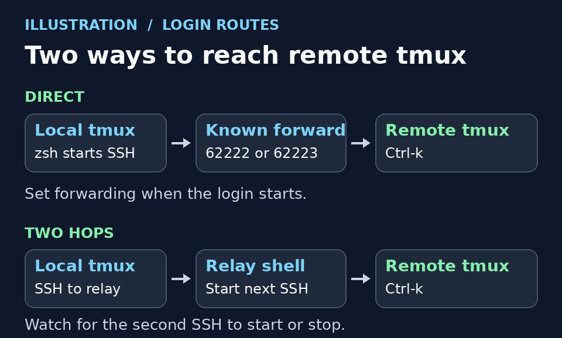
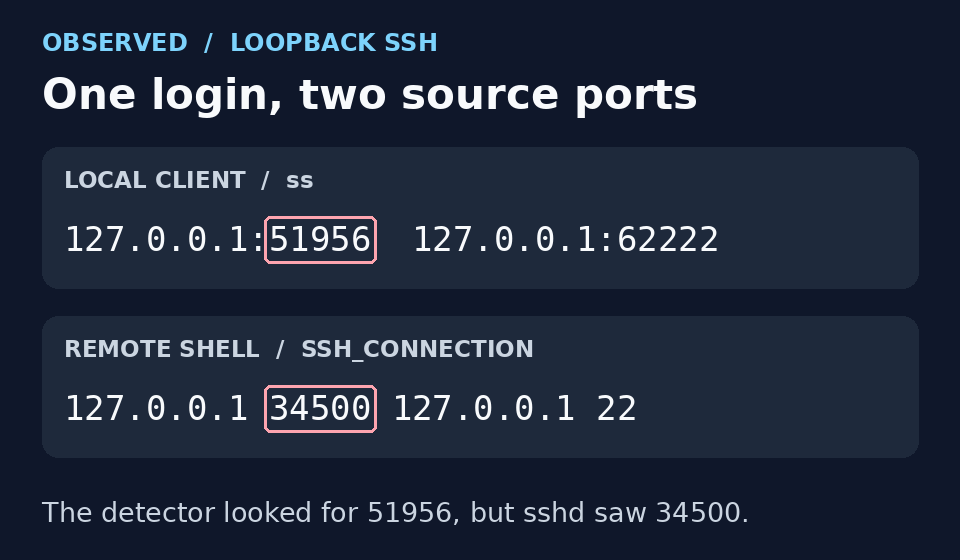
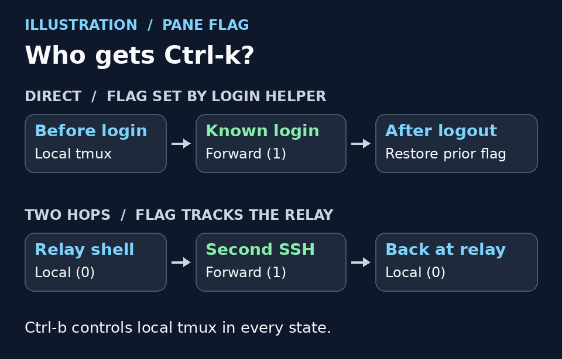

# Nested tmux over SSH: why Ctrl-k worked through a relay but not directly


`Ctrl-k` reached my remote tmux when I logged in through a relay, but the same key went to **local** tmux when I connected directly. The loopback login, `nb`, and `nbx` all reached the intended SSH server. The problem was how my local helper decided where to send the key.

The fix was to treat known forwarded endpoints differently from a relay. For ports `62222` and `62223`, I already knew the destination used `Ctrl-k`, so I could skip detection. For a relay, I still needed to detect when the second SSH connection started and ended. This follows up on my [two-hop tmux setup]({{&lt; relref &#34;2026-11-14-tmux-ssh-auto-prefix&#34; &gt;}}).

&lt;!--more--&gt;

## The situations I wanted to support

My local tmux 3.5a setup normally behaves as though its prefix is `Ctrl-k`. In fact, its real prefix is `Ctrl-b`; a root-table binding decides what to do with `Ctrl-k`. The destination tmux uses `Ctrl-k` as its real prefix.

| Where I am | What `Ctrl-k` should control |
|---|---|
| Local zsh, no SSH login | Local tmux |
| Direct SSH via loopback or `nb` (`62222`), or via `nbx` (`62223`) | Remote tmux when attached; the key passes through for the whole SSH login |
| Logged in to the relay, at its shell | Local tmux |
| Second SSH hop active from that relay | Remote tmux when attached; the key passes through while the second hop is active |
| Back at the relay after the second hop exits | Local tmux again |

`Ctrl-b` always controls local tmux. Hostnames and the LAN address below are replaced with examples; `192.0.2.82` is a documentation address, not a working target.



*Conceptual diagram: the direct route can be decided at login; the relay route needs to change while the first login is still open.*

Here are the direct commands and the two zsh shortcuts from `~/.tmux/scripts/me.sh`, with the example address substituted:

```zsh
# Direct loopback login from the local tmux pane.
ssh william@127.0.0.1 -p62222

# The two shortcuts also run from the local tmux pane.
nb()  { ssh william@192.0.2.82 -p62222; }
nbx() { ssh william@192.0.2.82 -p62223; }
```

For the two-hop route, I run `ssh relay.example` from local zsh. Then, **at the relay shell**, I run `ssh william@192.0.2.82 -p62222` and attach tmux on the destination as usual. The relay itself does not have to be running a tmux client for this to work.

## Why the direct login failed

The existing detector finds the local interactive SSH connection with `ss`, takes its TCP source port, and looks for the same port in `SSH_CONNECTION` on the server. That lets it find the login&#39;s own `SSH_TTY`, rather than querying an unrelated tmux client. The assumption is that **the source port is the same at both ends**.

I checked both ends of the same live loopback login. On the client I ran `ss -Htnp dport = :62222` and selected the row for the interactive `ssh` process. In the remote shell I read `SSH_CONNECTION`. These are excerpts from that test:

```text
ss (local addresses): 127.0.0.1:51956  127.0.0.1:62222
SSH_CONNECTION:       127.0.0.1 34500 127.0.0.1 22
```



*Rendered from the observed values, not a live screenshot. The red boxes mark the client port in each view.*

The connection to the forwarded port worked, but the destination `sshd` saw a different connection arriving on port `22`. Its source port was `34500`, not `51956`. The detector searched for `51956`, found no matching login terminal, and left `Ctrl-k` local. It did not fall back to a tmux-only lookup: a local port had been found, so it had already selected terminal-aware detection.

`nb` and `nbx` reach forwarded endpoints too. I checked both via the LAN address: each reported a loopback connection to port `22` in `SSH_CONNECTION`, and the destination tmux reported `C-k` as its configured prefix. The first fix covered only `127.0.0.1:62222`; that is why the explicit loopback command worked but `nb` still did not.

## The fix: one key binding, two routing policies

The local tmux binding did not need to change. Here is the part of `~/.tmux.conf` that decides where `Ctrl-k` goes:

```tmux
set -g prefix C-b
set -g prefix2 None
bind-key -T root C-k if-shell -F &#39;#{==:#{@remote_ctrl_k},1}&#39; \
    &#39;send-keys C-k&#39; \
    &#39;switch-client -T prefix&#39;
```

When the pane flag is `1`, tmux sends `Ctrl-k` into that pane and SSH carries it onwards. Otherwise, the next key uses the local prefix table. `if-shell -F` evaluates a tmux format; **pressing the key does not launch a shell or run an SSH probe**.

What changed was the code that sets the flag in [`~/.tmux/scripts/ssh-auto-prefix.sh`](ssh-auto-prefix.sh). The zsh `ssh()` wrapper calls this script for SSH started inside local tmux. The helper records the destination and the explicit `-p` value (both `-p62223` and `-p 62223` work) before choosing a policy:

- **Known direct endpoint:** match the exact user, address, and port. Set the pane flag to `1` before SSH starts; don&#39;t start an observer. This covers loopback `62222` and the LAN shortcuts `nb` (`62222`) and `nbx` (`62223`). Forwarding is intentional even before attaching remote tmux; it follows the login, not the tmux attachment.
- **Other interactive SSH logins:** start with the flag at `0` and let the [Python observer](ssh-prefix-watch.py) watch the first hop. A relay shell keeps `Ctrl-k` local. A detected foreground `ssh` or `autossh` on that terminal sends `Ctrl-k` downstream. When the foreground job returns to the shell, the observer sends it back to local tmux.
- **On logout:** restore whatever the pane flag was before SSH started. The helper skips routing for invocations such as explicit remote commands and `ssh -N` tunnels.



*Conceptual state diagram. The relay observer infers that the second hop should receive `Ctrl-k`; it does not verify that host&#39;s prefix.*

If you already have the local tmux binding and zsh wrapper from the earlier post, save the [updated Bash helper](ssh-auto-prefix.sh) and the [Python observer](ssh-prefix-watch.py) under `~/.tmux/scripts/`. Substitute your known endpoints in the Bash helper and reconnect. Leave the shortcut definitions in place. There is **no tmux or zsh reload** for a script-only update. If the flag is wrong in an already-open login, press `Ctrl-b`, then `F12` to toggle it for that local pane.

## What I tested

I used isolated tmux servers for tests that needed custom key bindings. The test bound `Z` to different actions on each side so I could tell which tmux had actually consumed the prefix.

| Path | Verified |
|---|---|
| `ssh william@127.0.0.1 -p62222` | Live login set and restored the pane flag. A separate isolated tmux test verified that a marked pane receives the `Ctrl-k` byte and `Ctrl-b` remains local. |
| `nb` | Live login from zsh. `Ctrl-k Z` invoked the remote test binding, `Ctrl-b Z` invoked the local one, and logout restored local `Ctrl-k`. |
| Relay → second SSH hop | `Ctrl-k Z` invoked the local binding at the relay and the remote binding after the second hop. `Ctrl-b Z` stayed local. `Ctrl-k d` detached remote tmux; exiting the second SSH hop made `Ctrl-k Z` local again. |
| `nbx` | Live login on `62223` set the forwarding flag; logout restored it. The destination reported `C-k`. I did not run a remote keystroke test on this port. |

To check routing from a different local pane without touching the remote configuration:

```bash
command tmux list-panes -a -F &#39;#{pane_id} #{pane_current_command} #{@remote_ctrl_k}&#39;
```

Look for `1` in the SSH pane when `Ctrl-k` should pass through. On the relay route the flag may take about one observer cycle to change. A missing flag, or `0`, means local routing.

## Takeaway

A successful SSH login proves the connection works. It does not prove both ends see the same TCP source port. For a known forwarded endpoint, set the routing policy at login. For a relay whose foreground job can change, keep the decision dynamic. In both cases, leave a separate key (`Ctrl-b` here) that always reaches local tmux.


---

> 作者: william  
> URL: https://williamlfang.github.io/2026-11-21-tmux-ctrl-k-ssh-forwarded-ports/  

